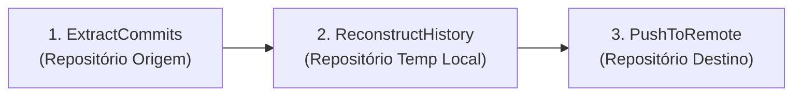

# Git Commit Migrator


Aplicação desktop Windows Forms (.NET 8) para migrar o histórico de contribuições de um repositório Git local para um novo repositório remoto usando **Ghost Commits** (commits vazios que preservam datas e mensagens originais sem expor o código-fonte).

---

## Como Funciona

O processo executa 3 etapas sequenciais (`MigrationService.RunMigration`):



1. **Extração (`ExtractCommits`)**: Varre todas as referências (`Refs`) do repositório local de origem, filtra os commits cujo e-mail do autor (`Author.Email`) corresponde ao e-mail informado (case-insensitive) e ordena cronologicamente (`When`).
2. **Reconstrução (`ReconstructHistory`)**:
   - Inicializa um novo repositório Git no diretório temporário.
   - Cria o arquivo `MIGRATION_INFO.md` com um commit inicial na branch `main`.
   - Recria cada commit filtrado usando `AllowEmptyCommit = true`, mantendo a mensagem e o timestamp original (`When`), mas atribuindo a assinatura ao novo nome e e-mail configurados.
3. **Publicação (`PushToRemote`)**: Adiciona o repositório remoto como `origin` e realiza o push da branch `refs/heads/main` autenticando via Personal Access Token (PAT).

---

## Campos da Interface

| Campo | Descrição |
|---|---|
| **Source Repo Path (Local)** | Caminho local do repositório Git original (onde está o histórico a extrair). |
| **Target Local Temp Path** | Pasta local vazia/temporária onde o novo repositório de ghost commits será montado. |
| **Target Remote URL** | URL HTTPS do repositório remoto de destino (ex.: `https://github.com/usuario/repo-historico.git`). |
| **Filter Original Email** | E-mail usado nos commits originais que devem ser filtrados e migrados. |
| **New Author Name** | Nome do autor que será gravado nos novos commits. |
| **New Author Email** | E-mail do autor que será gravado nos novos commits (vinculado à sua conta GitHub/GitLab). |
| **Target PAT Token** | Personal Access Token com permissão de escrita (`repo` / `contents:write`) no repositório de destino. |

---

## Requisitos e Execução

- **SO**: Windows x64
- **SDK**: .NET 8.0+

### Executar em modo desenvolvimento

```powershell
dotnet run --project Migrator/Migrator.csproj
```

### Gerar executável único (Self-Contained)

O projeto já está configurado para publicação *single-file* independente (`win-x64`):

```powershell
dotnet publish Migrator/Migrator.csproj -c Release
```

O binário `Git.Commit.Migrator.exe` será gerado em `Migrator/bin/Release/net8.0-windows/win-x64/publish/`.

---

## Estrutura do Projeto

```text
GitCommitMigration.slnx
└── Migrator/
    ├── Forms/
    │   └── MigratorForm.cs         # UI principal (Windows Forms)
    ├── Models/
    │   ├── CommitMetadata.cs       # Modelo dos metadados extraídos de cada commit (Message, When)
    │   └── RunMigrationRequest.cs  # DTO com os parâmetros de entrada da migração
    ├── Services/
    │   └── MigrationService.cs     # Motor de migração (ExtractCommits, ReconstructHistory, PushToRemote)
    ├── Program.cs                  # Ponto de entrada da aplicação
    └── Migrator.csproj             # Configuração de build .NET 8 / LibGit2Sharp
```
