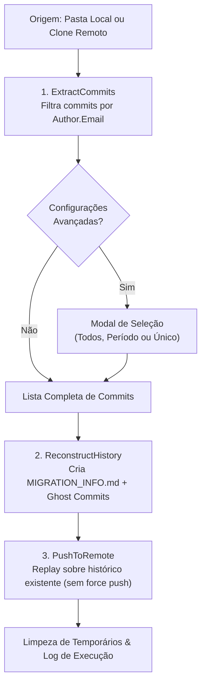

<p align="center">
  
</p>

# Git Commit Migrator

<p align="center">
  <strong>Preserve seu histórico e gráfico de contribuições do GitHub sem expor uma única linha de código proprietário.</strong>
</p>

<p align="center">
  <a href="https://cesarovies.github.io/GitCommitMigrator/"></a>
  <a href="https://github.com/CesarOvies/GitCommitMigrator/releases"></a>
  <a href="https://github.com/CesarOvies/GitCommitMigrator/stargazers"></a>
  <a href="https://github.com/CesarOvies/GitCommitMigrator/network/members"></a>
  <a href="https://github.com/CesarOvies/GitCommitMigrator/issues"></a>
  <a href="https://github.com/CesarOvies/GitCommitMigrator/graphs/contributors"></a>
  
  
  
  <a href="LICENSE"></a>
</p>

---

## 💡 O que é e Por Que Usar?

Ao trabalhar em empresas, consultorias ou repositórios privados de clientes, todo o seu histórico de commits geralmente fica restrito a essas organizações. Quando você sai de um projeto ou troca de empresa, seu perfil pessoal do GitHub não reflete o trabalho real que você desenvolveu ao longo dos anos.

O **Git Commit Migrator** resolve esse problema criando **Ghost Commits** (commits vazios) em um novo repositório pessoal:
- 🛡️ **Zero vazamento de código**: Nenhum arquivo, pasta, código-fonte ou segredo é transferido. Os commits são criados vazios (`AllowEmptyCommit = true`).
- 📅 **Preservação de datas e mensagens**: Mantém o timestamp exato (`When`) e a mensagem original de cada commit realizado por você.
- 🟩 **Gráfico de Contribuições Ativo**: O GitHub reconhece os commits e preenche seus quadradinhos verdes no painel de perfil.

> [!NOTE]
> Para exibir contribuições de repositórios privados no seu perfil do GitHub, ative a opção **"Include private contributions on my profile"** nas configurações de perfil da sua conta.

---

## ✨ Principais Recursos

- 📂 **Origem Flexível (Local ou Remoto)**: Suporta tanto pastas locais (`C:\Repos\MeuProjeto`) quanto URLs remotas (`https://github.com/...`), com suporte a repositórios privados via PAT de leitura.
- 🎯 **Seleção Avançada de Commits**:
  - Migrar todos os commits do autor filtrado.
  - Filtrar por **intervalo de datas** (período específico).
  - Selecionar um **único commit** específico.
- ⚡ **Push Inteligente & Idempotente**: Se o repositório de destino já possuir histórico, o migrador faz o replay dos ghost commits no topo da branch sem sobrescrever commits anteriores e ignorando duplicatas existentes.
- 📊 **Progresso em Tempo Real**: Feedback visual com barra de carregamento e descrição da etapa atual (extração, contagem de commits reconstruídos e push).
- 💾 **Exportação e Importação de Configurações**: Salve seus parâmetros em um arquivo `.json` reutilizável para migrar múltiplos repositórios com rapidez.
- 🔒 **Segurança Reforçada (DPAPI)**: Mascaramento visual de tokens na tela e criptografia de credenciais sensíveis via Windows DPAPI em logs de erro.
- 🧹 **Zero Lixo Residual**: O diretório temporário e arquivos transitórios de migração são higienizados automaticamente após a conclusão.
- 🌐 **Interface Multilíngue**: Suporte completo e dinâmico a Português (`PT-BR`), Inglês (`EN-US`) e Espanhol (`ES`).
- 🎨 **Tema Escuro Moderno**: Visual inspirado no GitHub Dark Theme com integração nativa ao DWM do Windows.

---

## 🚀 Como Usar (Guia Rápido)

Você pode utilizar o **Git Commit Migrator** de duas formas:

### Opção 1: Versão Web (Recomendada — Sem Instalação & 100% Responsiva)
Acesse diretamente pelo navegador no computador ou celular:
👉 [**https://cesarovies.github.io/GitCommitMigrator/**](https://cesarovies.github.io/GitCommitMigrator/)

- 📱 **Totalmente responsiva**: Funciona no celular (usando repositório remoto) e no desktop (suporta pasta local via File System API).
- 🔒 **100% Client-Side**: O código-fonte nunca sai da sua máquina; os commits vazios são enviados diretamente para a API do GitHub pelo seu navegador.

---

### Opção 2: Versão Desktop Windows (.exe Portable)
1. Acesse a página de [**Releases**](https://github.com/CesarOvies/GitCommitMigrator/releases) e baixe a versão mais recente do arquivo `.zip` portátil. Não requer instalação nem SDK do .NET pré-instalado (é *Self-Contained*).
2. Extraia e execute `Git.Commit.Migrator.exe`.

---

### 📝 Preenchendo os Campos (Web ou Desktop)

| Campo | Obrigatório? | Descrição | Exemplo |
|---|:---:|---|---|
| **Repositório de Origem** | Sim | Caminho da pasta local clonada ou URL HTTPS remota do repositório original. | `C:\Repos\ProjetoEmpresa` ou `https://github.com/org/repo.git` |
| **Token PAT de Origem** | Não | Necessário apenas se o repositório de origem for remoto e privado. | `ghp_xxxxxxxxxxxxxxxxxxxx` |
| **URL Remota de Destino** | Sim | URL HTTPS do repositório no seu GitHub que receberá as contribuições. | `https://github.com/seu-usuario/meu-historico.git` |
| **E-mail Original (Filtro)** | Sim | E-mail corporativo ou antigo com o qual você assinava os commits na origem. | `fulano@empresa-antiga.com` |
| **Nome do Novo Autor** | Sim | Nome público que você deseja assinar nos novos commits. | `Fulano de Tal` |
| **E-mail do Novo Autor** | Sim | E-mail vinculado e verificado na sua conta pessoal do GitHub. | `fulano@gmail.com` |
| **Token PAT de Destino** | Sim | Personal Access Token com permissão de escrita no repositório de destino. | `ghp_xxxxxxxxxxxxxxxxxxxx` |

> [!TIP]
> **Como gerar o Personal Access Token (PAT):**
> 1. No GitHub, acesse **Settings** > **Developer Settings** > **Personal Access Tokens** > **Tokens (classic)**.
> 2. Gere um novo token com o escopo **`repo`** (leitura/escrita).
> 3. Cole o token no campo correspondente no aplicativo.

### 3. (Opcional) Filtragem Avançada
Marque a opção **"Configurações Avançadas"** para abrir a janela de seleção:
- Escolha entre **Todos os Commits**, **Commit Único** ou defina um **Período de Datas** (Data Inicial e Data Final).
- Veja a contagem estimada de commits antes de confirmar.

### 4. Executar
Clique no botão verde **Executar Migração**. Acompanhe a barra de progresso. Ao final, uma mensagem de sucesso exibirá o caminho do relatório de migração gerado.

---

## 🔄 Como Funciona por Baixo dos Panos



1. **Extração (`ExtractCommits`)**: Percorre as referências (`Refs`) do repositório de origem, filtra os commits pertencentes ao e-mail informado e organiza cronologicamente (`When`). Se a origem for remota, realiza um clone *bare* temporário.
2. **Reconstrução (`ReconstructHistory`)**: Inicializa a estrutura no diretório de trabalho, gera o cabeçalho `MIGRATION_INFO.md` e recria cada commit selecionado com `AllowEmptyCommit = true`, preservando a mensagem e timestamp originais sob a nova assinatura do autor.
3. **Publicação (`PushToRemote`)**: Conecta-se ao repositório remoto via credenciais PAT, efetua fetch da branch `main` e, caso já haja commits remotos, faz o replay ordenado apenas dos novos commits (evitando duplicatas), enviando tudo via push padrão.
4. **Higiene & Auditoria**: Exclui artefatos transitórios e grava um relatório detalhado (`migration_log_*.txt`) com métricas da operação. Em caso de falha, dados sensíveis em logs são protegidos via DPAPI (`CurrentUser`).

---

## ❓ Perguntas Frequentes (FAQ)

<details>
<summary><strong>O que exatamente é um "Ghost Commit"?</strong></summary>
<br>
É um commit do Git que possui metadados válidos (autor, data, hora, fuso horário e mensagem de commit), mas que não introduz nenhuma árvore de arquivos (tree vazia / alteração nula). O Git e o GitHub registram o evento na linha do tempo sem que haja código armazenado.
</details>

<details>
<summary><strong>Existe risco de vazar segredos ou código proprietário da minha empresa?</strong></summary>
<br>
Não. O motor de migração utiliza a flag <code>AllowEmptyCommit = true</code> da biblioteca <code>LibGit2Sharp</code>. Nenhum arquivo, diff ou conteúdo dos arquivos da origem é lido ou incluído nos commits gerados.
</details>

<details>
<summary><strong>Se eu deletar o repositório de destino, perco as contribuições no perfil do GitHub?</strong></summary>
<br>
<strong>Sim.</strong> O GitHub calcula o gráfico de contribuições dinamicamente consultando os repositórios existentes na sua conta. Se o repositório for excluído, os commits deixam de existir e o GitHub removerá os pontos verdes correspondentes na próxima sincronização do cache (de alguns minutos até 24 horas). Se você deseja apenas que o repositório não seja visível publicamente, <strong>mantenha-o como Privado</strong> em vez de deletar.
</details>

<details>
<summary><strong>O repositório de destino precisa ser novo e vazio?</strong></summary>
<br>
Não obrigatoriamente. O aplicativo é capaz de detectar histórico pré-existente no repositório de destino e integrar os novos ghost commits sem utilizar force push (<code>--force</code>), preservando o histórico já presente.
</details>

<details>
<summary><strong>Preciso ter o .NET instalado no meu computador?</strong></summary>
<br>
Não. A versão Portable distribuída na aba de Releases é compilada como <em>Self-Contained</em> e <em>Single-File</em> para Windows x64, trazendo todos os componentes necessários embutidos.
</details>

---

## 🛠️ Ambiente de Desenvolvimento

### Requisitos
- **Sistema Operacional**: Windows 10/11 x64
- **SDK**: [.NET 8.0 SDK](https://dotnet.microsoft.com/download/dotnet/8.0) ou superior

### Compilar e Executar

```powershell
# Restaurar dependências e compilar
dotnet build GitCommitMigration.slnx

# Executar a aplicação desktop
dotnet run --project Migrator/Migrator.csproj

# Executar suíte de testes unitários e de integração
dotnet test GitCommitMigration.slnx
```

### Publicar Versão Portátil (Single-File)

```powershell
dotnet publish Migrator/Migrator.csproj -c Release
```
O executável compilado estará disponível em `Migrator/bin/Release/net8.0-windows/win-x64/publish/Git.Commit.Migrator.exe`.

---

## 🛡️ Governança, CI/CD e Segurança

O repositório implementa padrões de entrega contínua com validação automatizada:

- **Política de Branches & PRs (`ci.yml`)**:
  - Todo desenvolvimento e correções devem ter como alvo a branch `develop`.
  - A branch `main` só recebe alterações por meio de Pull Requests aprovados originados de `develop`.
  - PRs que violem a política de fluxo ou falhem na suíte de testes do `Migrator.Tests` são encerrados automaticamente.
- **Sincronização Contínua (`sync-develop.yml`)**:
  - Atualizações efetuadas na `main` são mescladas automaticamente de volta na `develop`.
- **Pipeline de Release (`release.yml`)**:
  - Gera automaticamente tags semânticas (`v1.0.x`).
  - Empacota o executável portátil (`.zip`).
  - Calcula hashes criptográficos **SHA-256** e **SHA-512**.
  - Executa análise antimalware com **Microsoft Defender** e relatório no **VirusTotal**.
  - Gera atestado de proveniência de compilação (**SLSA Build Provenance**).
  - Publica os artefatos no **GitHub Packages** e no **GitHub Releases**.

---

## 🤝 Como Contribuir

Contribuições da comunidade são muito bem-vindas! Para manter a integridade, estabilidade e automação contínua do projeto, seguimos regras estritas de governança:

### ⚠️ Regras Essenciais de Governança

1. **Branch de Destino Obrigatória (`develop`)**:
   - Todo Pull Request **deve ser aberto obrigatoriamente contra a branch `develop`**.
   - Pull Requests abertos diretamente contra a `main` (que não venham de `develop`) são **fechados automaticamente pelo robô de CI**.
2. **Suíte de Testes Obrigatória**:
   - Todos os testes unitários e de integração em `Migrator.Tests` precisam passar (`dotnet test`).
   - Se o build ou algum teste falhar na pipeline do GitHub Actions, o PR é **rejeitado e fechado automaticamente**.
3. **Padrão de Nomenclatura de Branches**:
   - `feat/nome-da-funcionalidade` para novos recursos.
   - `fix/nome-da-correcao` para correções de bugs.
   - `docs/nome-do-ajuste` para atualizações de documentação.
   - `chore/nome-da-tarefa` para manutenção interna ou CI/CD.
4. **Preenchimento do Template de PR**:
   - Mantenha e preencha as seções obrigatórias de descrição, motivação, tipo de mudança, testes validados e assinatura caso tenha utilizado assistência de agentes de IA.

### 📝 Passo a Passo para Submeter uma Contribuição

1. Faça um **Fork** deste repositório para o seu perfil.
2. Clone o seu repositório bifurcado localmente:
   ```powershell
   git clone https://github.com/SEU-USUARIO/GitCommitMigrator.git
   cd GitCommitMigrator
   ```
3. Crie uma nova branch a partir da **`develop`**:
   ```powershell
   git checkout develop
   git pull origin develop
   git checkout -b feat/minha-contribuicao
   ```
4. Implemente as mudanças mantendo estilo e padrões do projeto.
5. Valide o build e execute todos os testes localmente:
   ```powershell
   dotnet build GitCommitMigration.slnx
   dotnet test GitCommitMigration.slnx
   ```
6. Faça commit das alterações e envie para o seu fork:
   ```powershell
   git add .
   git commit -m "feat: implementa nova melhoria no extrator"
   git push -u origin feat/minha-contribuicao
   ```
7. Abra o **Pull Request** no GitHub selecionando a branch de base **`develop`** (nunca `main`).

---

## 👥 Contribuidores

Agradecemos imensamente a todas as pessoas que dedicam seu tempo para construir e aprimorar este utilitário!

<p align="center">
  <a href="https://github.com/CesarOvies/GitCommitMigrator/graphs/contributors">
    
  </a>
</p>

---

## ⚖️ Isenção de Responsabilidade Legal e Técnica (Disclaimer)

Esta aplicação foi desenvolvida exclusivamente como utilitário técnico para preservação de métricas históricas individuais via commits vazios (*ghost commits*). Ao baixar, compilar ou executar este software, o usuário concorda expressamente com os seguintes termos:

1. **Custódia e Sigilo de Credenciais**: O usuário é integral e exclusivamente responsável pela geração, armazenamento, guarda, revogação e nível de permissão concedido a qualquer *Personal Access Token* (PAT), chave de acesso, credencial Git ou segredo inserido na ferramenta. O autor e os mantenedores deste projeto **não se responsabilizam** por vazamentos, comprometimento de contas, exposições acidentais decorrentes de estações de trabalho comprometidas, configurações locais inseguras ou uso inadequado de tokens.
2. **Conformidade Corporativa e Termos de Serviço**: O usuário assume total responsabilidade por garantir que a extração de metadados (como mensagens de commit e cronologia) esteja em estrita conformidade com eventuais Acordos de Não Divulgação (NDAs), políticas de segurança da informação de seus empregadores/clientes e os Termos de Serviço dos provedores de hospedagem Git envolvidos.
3. **Ausência de Garantias e Isenção de Danos ("AS IS")**: Sob os termos da licença MIT, o software é disponibilizado "no estado em que se encontra", sem garantias explícitas ou implícitas de qualquer natureza. Sob nenhuma circunstância o autor ou mantenedores serão responsabilizados por quaisquer perdas, danos diretos, indiretos, perda de dados ou consequências oriundas do uso indevido, fraudulento ou negligente desta ferramenta.

---

## 📄 Licença

Distribuído sob a licença **MIT**. Consulte o arquivo [LICENSE](LICENSE) para mais detalhes.
